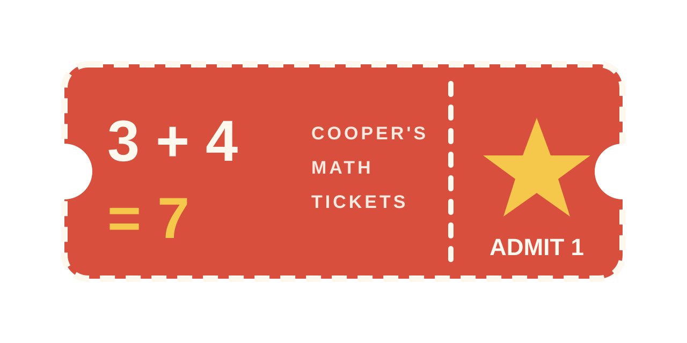

<p align="center"></p>

# Cooper's Math Tickets

A single-page web app for a first grader. Math practice earns tickets; tickets buy video time and stickers. Built for an iPad, runs anywhere with a browser, no server and no build step.

## How a session works

1. **Math probes** — three one-minute probes of first-grade addition (sums within 20) and subtraction (within 10). Answer at least 8 and get 80% right to earn **1 ticket**.
2. **Tic-tac-toe** — one game for each ticket earned that session. Cooper is X. The computer starts at level 1 (easy to beat) and climbs one level per win, drops one per loss, across 10 levels. Levels 1–5 stay easy; it only plays like a grown-up at 9–10.
3. **Chess lesson** — one short, tap-the-square lesson read aloud with the device's text-to-speech. Ten lessons in order (the board, king, rook, bishop, queen, knight, pawn, find the king, find the queen, capture), then they repeat. A correct answer pays **2 tickets** and offers two choices: another lesson, or go to videos.
4. **Spend** — watch videos (3 tickets = 30 minutes), visit the sticker store, or save.

The home screen shows the ticket bank and a scoreboard: tic-tac-toe wins/ties/losses, chess lessons passed, and tickets earned ever.

## Sticker store

Stickers cost 3, 5 or 8 tickets. Buying one deducts the tickets and tells Cooper to ask a parent for the real sticker; the parent panel lists what he's owed with a **Given** button. The app shows a letter badge per sticker until a parent adds a photo of the real sticker (the app does not draw any characters).

## Parent panel

Collapsed at the top of the page. From there you can jump to any screen, add or remove bank tickets, change any sticker's price, add or remove stickers, add sticker pictures, mute the voice, fast-forward timers for testing, and reset everything.

## Rules you can change

All the numbers live at the top of the script in `index.html`:

```js
const RULES = { probesNeeded: 3, passPct: 80, minAnswered: 8, probeSecs: 60, rewardMins: 30, videoCost: 3, chessTickets: 2 };
```

The default sticker list is `DEFAULT_STORE` right below it.

## Storage

Everything (bank, scores, store prices, owned stickers, lesson progress) is saved in the browser's `localStorage` on the device where the page is opened. Sticker pictures are saved separately on the same device, shrunk to 200×200. Nothing is sent anywhere.

## Running it

Open `index.html` in a browser, or host the file anywhere static (GitHub Pages works: Settings → Pages → deploy from the `main` branch root). Text-to-speech uses the browser's built-in voices and only starts after a tap, so the first lesson may be silent until the "Say it again" button is pressed.

## Files

- `index.html` — the whole app
- `docs/logo.svg`, `docs/logo.png`, `docs/logo-small.png` — logo
